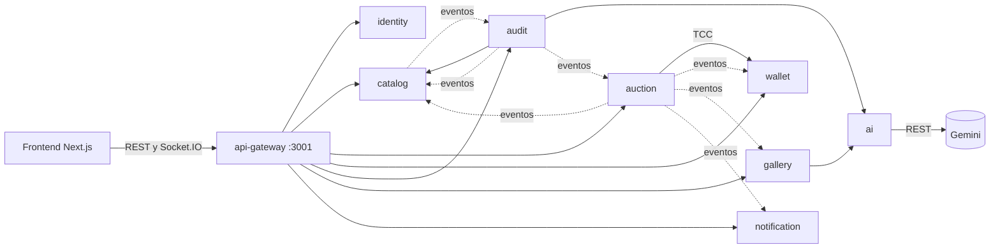

# ArtAuction AI — Backend

Backend de **ArtAuction AI**, una casa de subastas de arte en línea con auditoría de autenticidad asistida por IA. Los vendedores publican obras, la plataforma las audita antes de mostrarlas, y los coleccionistas pujan en salas en vivo con artacoins, la moneda interna. Cada usuario tiene además una galería 3D y una galería social.

El backend es un monorepo de **nueve microservicios** NestJS que se comunican por **gRPC sobre HTTP/2**. Un api-gateway le ofrece al frontend REST y Socket.IO. La única llamada REST hacia fuera es la de Gemini, encapsulada en ai-service. Todo es funcional salvo la pasarela de pago, que se simula.

## Arquitectura



Flechas sólidas: gRPC síncrono. Punteadas: eventos por outbox transaccional, con consumidores idempotentes.

| Servicio | Puerto | Responsabilidad |
|---|---|---|
| [api-gateway](services/api-gateway) | HTTP 3001 | REST, Socket.IO, validación, rate limit, composición de lecturas, OpenAPI |
| [identity-service](services/identity-service) | 50051 | cuentas, login, refresh rotativo, JWT RS256, tokens de servicio |
| [catalog-service](services/catalog-service) | 50052 | obras, imágenes en S3, hash perceptual, ciclo de vida, revisión manual |
| [wallet-service](services/wallet-service) | 50053 | saldo, retenciones TCC, ledger, recargas idempotentes, comisión |
| [auction-service](services/auction-service) | 50054 | salas, pujas, anti-sniping, programador, stream en vivo |
| [ai-service](services/ai-service) | 50055 | única dueña de la clave de Gemini, con circuit breaker y evaluación local de respaldo |
| [audit-service](services/audit-service) | 50056 | cola de auditoría, expediente de evidencias, reglas deterministas, informes |
| [gallery-service](services/gallery-service) | 50057 | galería 3D, galería social, follows y feed |
| [notification-service](services/notification-service) | 50058 | avisos |

Para entender el sistema, en este orden:

1. [Arquitectura](docs/arquitectura/arquitectura.md): despliegue, capas, outbox, y los flujos de auditoría, puja y cierre, con diagramas.
2. [Mapa de contextos](docs/arquitectura/contextos.md): eventos y propiedad de los datos.
3. [ADR](docs/arquitectura/adr): por qué se decidió cada cosa.
4. [Plan de migración](docs/arquitectura/plan-microservicios.md): cómo se pasó del monolito a los servicios, fase por fase.

## Reglas de dominio

- **Auditoría antes de publicar.** Una obra enviada pasa por audit-service, que la mide (resolución, nitidez, saturación, EXIF, duplicados en el catálogo) y aplica reglas deterministas. Un conflicto crítico, como acrílico antes de 1950 o una imagen copiada de otro vendedor, la manda a revisión manual sin consultar a la IA. Si no hay conflicto, la IA evalúa el expediente **sin ver imágenes**, y cada hallazgo debe citar sus evidencias. Una obra con score menor que 40 también va a revisión.
- **Pujas.** En artacoins enteras. La primera debe llegar al precio de salida y las siguientes al precio actual más el incremento. El vendedor no puja en su propia sala. Una puja en los últimos 30 s alarga el cierre otros 30 s. El reloj es el del servidor. Cada puja lleva su clave de idempotencia y reserva saldo con Try-Confirm-Cancel.
- **Cierre.** Si hay ganador, wallet le cobra, devuelve las reservas de los demás y abona al vendedor el precio menos un 10 % de comisión. La obra pasa a la galería del ganador. Una sala sin pujas se reprograma.
- **Privacidad.** Una obra privada responde 404 a quien no es su vendedor.

## Levantar la plataforma

Requisitos: Docker y Node.js 24. Los tres repositorios deben estar como carpetas hermanas:

```
artauction/
  artauction_backend/    este repo
  artauction_bd/         migraciones, roles y semilla
  artauction_frontend/   Next.js
```

Una sola vez, en este repo:

```bash
npm ci
node scripts/generate-keys.mjs     # claves RS256, secretos de cliente y de Garage en secrets/
node scripts/compose-secrets.mjs   # contraseñas de Postgres y secreto del frontend
```

Después, cada vez:

```bash
npm run compose:up       # construye y levanta todo; la primera vez tarda varios minutos
npm run compose:down     # detiene; con "-- -v" borra también los datos
```

| Dirección | Qué es |
|---|---|
| http://localhost:3000 | frontend |
| http://localhost:3001 | api-gateway |
| http://localhost:3001/docs | OpenAPI (Swagger UI) |
| http://localhost:3902 | lectura pública de imágenes |

Cuentas de la semilla, todas con la contraseña `DevPassword!234`: `admin@artauction.local` (ADMIN), `seller@artauction.local` (SELLER), `leo@artauction.local` y `nora@artauction.local` (USER).

**Gemini es opcional.** Con `GEMINI_API_KEY` en `services/ai-service/.env`, la auditoría y el asistente de galería usan el modelo. Sin clave, ai-service usa una evaluación local determinista y todo sigue funcionando.

**Puertos.** Se cambian con `FRONTEND_PORT`, `GATEWAY_PORT`, `S3_PORT` y `MEDIA_PORT`. El proyecto de compose se llama `artauction-platform`, así no toca los contenedores de desarrollo de la carpeta raíz. Eso sí, los dos usan los puertos 3900 y 3902 de Garage: detén la infraestructura de desarrollo antes, o cambia esos puertos.

### Desarrollar un servicio

Para iterar sobre un servicio sin reconstruir imágenes, se puede correr cada proceso con `npm start -w @artauction/<servicio>` contra la infraestructura de la carpeta raíz. Cada servicio documenta en su README y en su `.env.example` lo que necesita.

## Comandos

| Comando | Qué hace |
|---|---|
| `npm run build` | compila paquetes y servicios |
| `npm run typecheck` | typecheck de todo el monorepo |
| `npm run lint` | ESLint con las reglas de fronteras entre capas |
| `npm test` | pruebas unitarias y de capa de cada paquete y servicio |
| `npm run lint:proto -w @artauction/contracts` | `buf lint` de los contratos |
| `npm run e2e` | prueba de punta a punta contra la plataforma levantada ([e2e/](e2e)) |
| `npm run compose:up` / `compose:down` | levantar y detener la plataforma |

## Estructura

```
packages/contracts     contratos .proto versionados (buf) y código generado con ts-proto
packages/platform      logger, configuración, errores, resiliencia, verificación JWT, outbox
packages/service-kit   servidor gRPC con health, handlers y clientes con deadline
services/<servicio>    un microservicio por contexto: src/api (frontera) y src/internal (dominio)
e2e/                   prueba de punta a punta por el gateway
scripts/               secretos, bootstrap de Garage y healthcheck gRPC de los contenedores
compose.yaml           la plataforma completa
Dockerfile             imagen multi-stage; ARG SERVICE elige el servicio
docs/                  arquitectura, ADR, OpenAPI y contrato WebSocket
```

Dentro de cada servicio, `internal` no puede importar `api`, gRPC ni código de otro servicio, y `domain` no conoce frameworks. ESLint lo hace cumplir.

## Contratos

Publica:

- REST, descrito con OpenAPI en `/docs` y `/docs-json` ([docs/openapi](docs/openapi/v1.md));
- el catálogo de eventos de Socket.IO ([docs/websocket](docs/websocket/v1.md));
- entre servicios, los `.proto` de `packages/contracts`, que `buf breaking` protege en cada PR.

Consume: los esquemas de Postgres y Mongo de `artauction_bd`, versionados con tags semánticos. Ningún servicio redefine el modelo por su cuenta.

## CI

`.github/workflows/ci.yml` tiene dos jobs, que corren en cada PR y en `main`:

1. **microservices**: `buf lint`, `buf breaking` frente a la rama base, build, lint, typecheck de la e2e y pruebas.
2. **compose and e2e**: clona los repos hermanos, genera secretos efímeros, levanta compose y corre la e2e. Si falla, guarda los logs.

El ref de los repos hermanos sale de las variables del repositorio `ARTAUCTION_BD_REF` y `ARTAUCTION_FRONTEND_REF` (por defecto `main`). Si esos repos son privados, hace falta el secreto `SIBLING_REPOS_TOKEN` con permiso de lectura.

## Seguridad

- Argon2 para contraseñas. Access token RS256 corto y refresh rotativo; reusar un refresh revocado revoca toda la familia.
- Zero trust: cada servicio verifica el JWT de cada llamada gRPC, y las RPC internas comprueban qué servicio llama.
- Mínimo privilegio: un login de Postgres por servicio; la clave de Gemini solo en ai-service.
- Idempotencia en pujas, recargas (`Idempotency-Key`) y consumidores de eventos.
- Los secretos viven en `secrets/` y en los `.env`, fuera de git y de las imágenes.

## Convenciones

- Commits en [Conventional Commits](https://www.conventionalcommits.org/), verificados por commitlint y Husky.
- Trabajo en ramas `feat/...` e integración con `merge --no-ff` en los hitos.
- TypeScript estricto, ESLint y Prettier.
- Logs estructurados en JSON, con correlation id.
