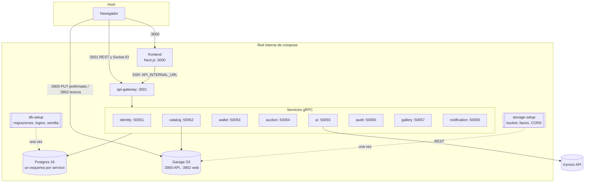
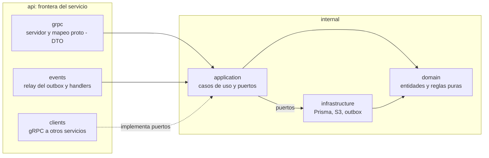
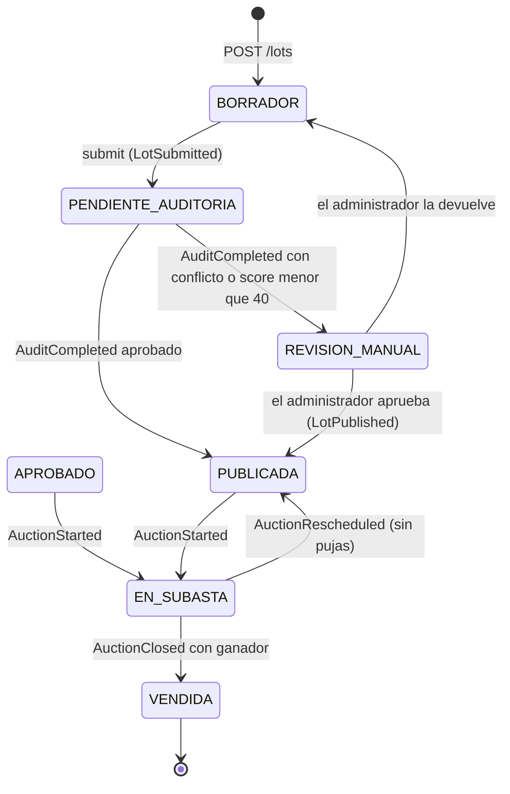
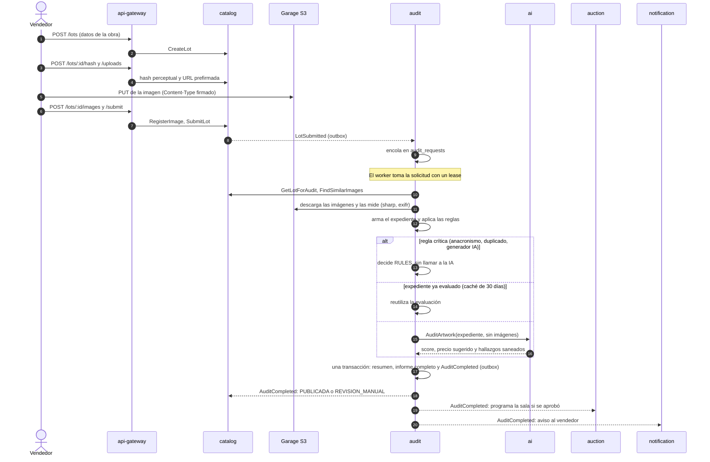
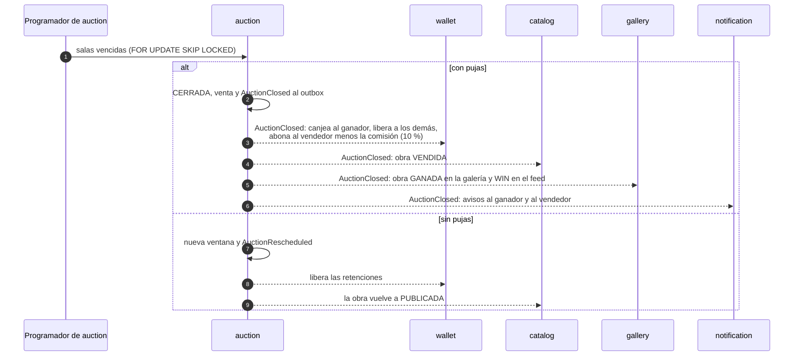

# Arquitectura de ArtAuction AI

Este documento describe la plataforma tal como queda al cerrar la migración (F9). El mapa de contextos y la propiedad de los datos están en [contextos.md](contextos.md); las razones de cada decisión, en los [ADR](adr). Aquí se ve cómo encajan las piezas y cómo viajan los flujos que cruzan servicios.

## Vista general

ArtAuction AI es una casa de subastas de arte con auditoría de autenticidad asistida por IA. El backend son nueve procesos Node.js 24 (NestJS) que se reparten el dominio por contextos acotados:

| Servicio | Puerto | Responsabilidad | Datos propios |
|---|---|---|---|
| `api-gateway` | HTTP 3001 | REST y Socket.IO del frontend, validación, rate limit, composición, OpenAPI | ninguno |
| `identity-service` | gRPC 50051 | cuentas, login, refresh rotativo, firma JWT RS256, tokens de servicio | PG `identity` (cuentas y sesiones) |
| `catalog-service` | gRPC 50052 | obras, imágenes, hash perceptual, ciclo de vida del lote, revisión manual | PG `catalog`, bucket S3 |
| `wallet-service` | gRPC 50053 | saldo en artacoins, retenciones TCC, ledger, recargas con pasarela simulada | PG `wallet` |
| `auction-service` | gRPC 50054 | salas, pujas, anti-sniping, programador, stream en vivo | PG `auction` |
| `ai-service` | gRPC 50055 | única dueña de la clave de Gemini; REST hacia el modelo con circuit breaker | ninguno |
| `audit-service` | gRPC 50056 | cola de auditoría, expediente de evidencias, reglas, informes | PG `audit` (informes en JSONB) |
| `gallery-service` | gRPC 50057 | galería 3D personal, galería social, follows y feed | PG `gallery` |
| `notification-service` | gRPC 50058 | avisos al usuario | PG `notification` |

Tres reglas sostienen el diseño:

1. **Cada servicio es dueño de sus datos.** Un solo motor, PostgreSQL, con un esquema por servicio (ADR 0003 y 0010), con un login propio (`<servicio>_svc`) que no puede leer los demás. No hay claves foráneas entre contextos: lo que un servicio necesita de otro llega por gRPC o en un evento.
2. **gRPC síncrono solo cuando la respuesta hace falta ya.** El resto viaja como evento, por un outbox transaccional, a consumidores idempotentes.
3. **Ningún servicio confía en la red.** Cada llamada lleva un JWT (de usuario o de servicio) que el receptor verifica con la clave pública de identity.

## Despliegue con docker compose

`compose.yaml` levanta la plataforma completa. Solo el frontend, el gateway y Garage publican puertos en el host; Postgres y los puertos gRPC quedan en la red interna de compose.



**Orden de arranque.** compose lo resuelve con `depends_on` y healthchecks:

1. Postgres y Garage.
2. Los jobs `db-setup` y `storage-setup`, que deben terminar con código 0:
   - `db-setup` construye la imagen de `artauction_bd`, aplica las migraciones, crea los logins de servicio y siembra la base solo si está vacía;
   - `storage-setup` crea el bucket, la llave de catalog y la de administración, el acceso web público y la política CORS.
3. Los ocho servicios gRPC, cada uno sano según `grpc.health.v1`.
4. El gateway, cuando todos están sanos.
5. El frontend.

**Imagen única.** El `Dockerfile` del backend es multi-stage con `ARG SERVICE`. Una sola receta construye cualquiera de los nueve servicios: compila los paquetes compartidos y el servicio elegido, y la etapa final instala solo las dependencias de producción y corre como usuario `node`.

**Secretos fuera de las imágenes.** `.dockerignore` excluye `secrets/` y los `.env`. Las claves RS256 se montan como archivos de solo lectura; las contraseñas llegan por variables desde `secrets/compose.env` y `secrets/service-clients.env`, que generan `scripts/generate-keys.mjs` y `scripts/compose-secrets.mjs` y nunca se versionan.

## Capas de un servicio

Cada servicio separa lo que decide de lo que comunica. ESLint (`no-restricted-imports`) hace cumplir las fronteras: un import prohibido rompe el lint y la CI.



- `internal` no importa `api`, `@artauction/contracts`, `@grpc/*` ni código de otro servicio.
- `internal/domain` no importa frameworks ni persistencia.
- `internal/application` depende de puertos (interfaces), no de `infrastructure`. La raíz de composición (`<servicio>.module.ts`) conecta las implementaciones.

Los paquetes compartidos no tienen reglas de negocio:

- `packages/contracts`: los `.proto` versionados y el código generado con ts-proto;
- `packages/platform`: logger, configuración, errores, resiliencia, verificación JWT y outbox;
- `packages/service-kit`: el servidor gRPC con health y los clientes con deadline.

## Eventos: outbox e inbox

Un cambio de estado y el evento que lo anuncia se guardan en la **misma transacción** local, en la tabla `outbox` del esquema del productor. Un relay los entrega después por gRPC al consumidor, con un token de servicio, en orden por agregado y con backoff exponencial. El consumidor anota el `event_id` en su `inbox` dentro de la transacción del efecto, así que un evento repetido no se aplica dos veces.

```mermaid
sequenceDiagram
  autonumber
  participant UC as Caso de uso (productor)
  participant DB as Postgres del productor
  participant R as OutboxRelay
  participant C as Consumidor
  participant CDB as Base del consumidor

  UC->>DB: BEGIN; cambio de estado; INSERT outbox; COMMIT
  loop cada intervalo
    R->>DB: lee eventos pendientes (en orden por agregado)
    R->>C: HandleEvent(evento, token de servicio)
    C->>CDB: BEGIN; ¿event_id en inbox?
    alt ya procesado
      C-->>R: OK (sin efecto)
    else nuevo
      C->>CDB: efecto + INSERT inbox; COMMIT
      C-->>R: OK
    end
    R->>DB: marca el evento como entregado
  end
  Note over R,C: Si el consumidor falla, el relay reintenta con backoff.<br/>La entrega es al menos una vez; la inbox la vuelve exactamente una vez en efecto.
```

Ni la caída del productor ni la del consumidor pierden un evento: si no hay commit, no hay evento; si hay commit, el relay insiste hasta que el consumidor lo confirme.

## Ciclo de vida de una obra

catalog-service es el dueño del estado del lote. Lo mueven los comandos del vendedor y del administrador, y los eventos de audit y auction.



`APROBADO` es el estado de las obras anteriores a la migración que ya estaban aprobadas; se subastan igual que las `PUBLICADA`. Una obra privada responde 404 a cualquiera que no sea su vendedor, y una vendida sale del catálogo público.

## Publicar y auditar

La auditoría nunca corre dentro de una petición HTTP. El vendedor recibe respuesta en cuanto la obra queda en la cola, y el resultado llega después por eventos.



La IA nunca ve imágenes: razona sobre evidencias ya medidas, cada hallazgo debe citar códigos del expediente y una regla crítica no se puede anular (ADR 0009). Sin `GEMINI_API_KEY`, ai-service usa una evaluación local determinista, y la plataforma sigue funcionando.

## Pujar: Try-Confirm-Cancel

Una puja toca dos recursos con dueños distintos: la sala (auction) y el saldo (wallet). No hay transacción distribuida. Se coordinan con TCC, y la llamada remota nunca se hace con una fila bloqueada.

```mermaid
sequenceDiagram
  autonumber
  actor P as Postor
  participant GW as api-gateway
  participant AUC as auction
  participant WAL as wallet

  P->>GW: POST /auctions/:id/bids {amount, idempotencyKey}<br/>o bid:place por Socket.IO
  GW->>AUC: PlaceBid (token del postor)
  AUC->>AUC: validación previa sin bloqueo
  AUC->>WAL: TryHold(diferencia, misma clave)
  WAL-->>AUC: reservation_id (vence en 2 min)
  AUC->>AUC: BEGIN; FOR UPDATE de la sala; validación estricta;<br/>guarda la puja; anti-sniping; BidAccepted al outbox; COMMIT
  AUC-->>GW: bidId
  AUC-->>GW: WatchAuction: bid:accepted a la sala
  AUC-->>WAL: BidAccepted (outbox)
  WAL->>WAL: ConfirmHold
  Note over AUC,WAL: Si la transacción local falla tras el Try, la reserva queda huérfana.<br/>Al vencer, wallet pregunta GetBidByReservation: confirma si la puja existe, si no, libera.
```

La misma `idempotencyKey` devuelve la misma puja con `idempotent: true` y no reserva dos veces. El frontend envía cada puja por los dos canales con la misma clave, así que una caída del socket no pierde la puja ni la duplica.

## Cierre y liquidación



wallet bloquea los bolsillos en orden de id, así que dos cierres no se esperan en sentidos opuestos y no hay deadlocks. La comisión se guarda en `wallet.platform_fees`, con la subasta como llave primaria, para que no se cobre dos veces.

## Seguridad

- **Identidad.** Argon2 para contraseñas. Access token RS256 corto y refresh rotativo con detección de reutilización. Solo identity tiene la clave privada.
- **Zero trust.** Cada servicio verifica el JWT de cada llamada. Los servicios se autentican con tokens de servicio (client credentials), y cada RPC interna comprueba qué cliente llama. Por ejemplo, `GetBidByReservation` solo acepta a wallet.
- **Mínimo privilegio.** Un login de Postgres por servicio, limitado a su esquema. La clave de Gemini solo existe en ai-service. La llave S3 de catalog no puede administrar el bucket.
- **Entradas.** El gateway valida la forma y los servicios validan las reglas. Los cuerpos tienen límite (1 MB, 12 MB en `/lots`). Hay rate limit por ruta y CORS limitado a `CORS_ORIGINS`.
- **Imágenes.** Solo se sube con una URL prefirmada de corta duración que emite catalog para una obra propia. El Content-Type va firmado (un `text/html` se rechaza con 403). CORS limita desde qué orígenes puede subir un navegador; el control de acceso es la firma.
- **Idempotencia.** Las pujas llevan `idempotencyKey`. Las recargas exigen `Idempotency-Key` (la misma clave con otro cuerpo responde 409). Los consumidores de eventos usan su inbox.

## Verificación

| Nivel | Dónde | Qué cubre |
|---|---|---|
| Unitarias y de capa | `services/*/test`, `packages/*/test` (Jest) | reglas de dominio, casos de uso con puertos falsos, mapeos gRPC, gateway con servicios falsos |
| Fronteras | `npm run lint` | que ninguna capa importe lo que no debe |
| Contratos | `buf lint` y `buf breaking` en CI | estilo de los `.proto` y cambios incompatibles frente a la rama base |
| Punta a punta | [`e2e/`](../../e2e) contra `docker compose` | identidad, publicación y auditoría, revisión manual, bolsillo, sala en vivo, liquidación, galería, feed y avisos |
