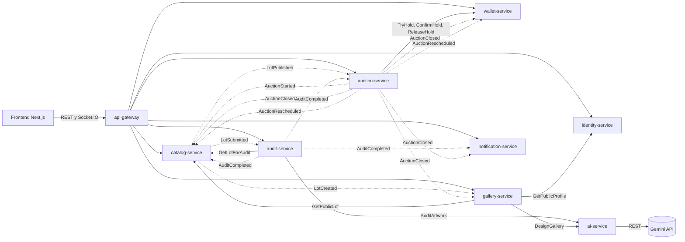

# Mapa de contextos

Flechas solidas: llamadas gRPC sincronas. Flechas punteadas: eventos entregados por el outbox del productor.

## Propiedad de los datos

| Dato | Dueno | Quien lo necesita y como lo obtiene |
|---|---|---|
| Usuario, rol, perfil | identity | los demas leen `sub` y `role` del JWT; gallery pide el perfil publico por gRPC |
| Lote, imagenes, categorias, score | catalog | auction guarda una copia de `lotId`, `sellerId` y `title` al programar; gallery consulta por gRPC |
| Estado del lote `EN_SUBASTA` y `VENDIDA` | catalog | se actualiza con eventos de auction |
| Subasta, pujas, ventas | auction | el gateway compone el resumen en las tarjetas del catalogo |
| Saldo, retenciones, ledger, ordenes de pago | wallet | auction reserva y confirma por gRPC |
| Resumen e informe de auditoria | audit | el gateway compone el ultimo resumen en la ficha de la obra |
| Galeria personal y social, follows, feed | gallery | solo el gateway |
| Notificaciones | notification | solo el gateway |
